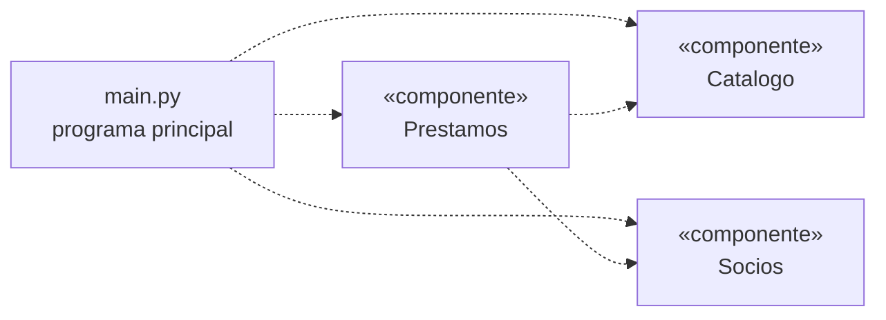

# Biblioteca de barrio

Primera versión de la aplicación de una biblioteca de barrio, en **Python** (consola) y como **aplicación web** (GitHub Pages).

🌐 **Versión web:**(https://alejandracarmonamaro-star.github.io/biblioteca/)  *(cambia este enlace por el tuyo)*

## Estructura

| Fichero | Qué hace |
|---|---|
| `catalogo.py` | Componente **Catalogo**: guarda libros y ejemplares. Ofrece `buscar(titulo)`, `obtener(id)` y `marcar_prestado(id)` (+ `marcar_devuelto`, `num_disponibles`). |
| `socios.py` | Componente **Socios**: altas de socios y sanciones. |
| `prestamos.py` | Componente **Prestamos**: préstamos, devoluciones y reservas. Solo usa las funciones públicas de los otros dos. |
| `main.py` | Junta los tres componentes y ofrece un menú por consola. |
| `test_biblioteca.py` | Pruebas automáticas de las reglas. |
| `docs/` | Versión web (se publica con GitHub Pages). |
| `DIARIO.md` | Diario, con la decisión sobre la petición del cliente. |

## Diagrama de componentes

Cada flecha es una dependencia (quién usa a quién):



Versiones en imagen y en UMLet: `diagrama_componentes.png` y `diagrama_componentes.uxf`.

## Reglas implementadas

- Un socio no puede tener más de **2 libros** a la vez.
- Cada préstamo **caduca a los 7 días**. Si se devuelve tarde, el socio queda sancionado tantos días como de retraso.
- Cada título tiene **varios ejemplares**, cada uno con su propio estado.
- Un socio **sancionado** no puede pedir libros (ni reservarlos).
- Se pueden **reservar** libros que ya están todos prestados. El ejemplar devuelto se guarda para el primero de la cola.

## Cómo ejecutarlo

```bash
python main.py                 # aplicación de consola
python -m unittest -v          # pruebas
```

En el menú, la opción **7** avanza días para poder probar la caducidad y las sanciones sin esperar una semana.

Para la versión web en local, abre la carpeta `docs/` con la extensión *Live Server* de VS Code (los módulos de JavaScript no funcionan abriendo el `index.html` con doble clic).
